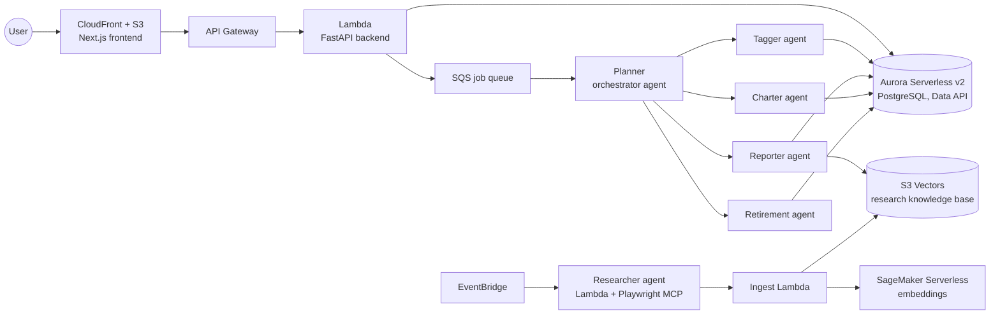

# Alex: Multi-Agent AI Financial Planner on AWS

**Alex** (Agentic Learning Equities eXplainer) is a SaaS app that analyses a user's investment portfolio. You sign in, enter your accounts and holdings, and a team of AI agents writes a portfolio report, draws allocation charts and projects your retirement outcomes. Everything runs serverless on AWS and is defined in Terraform.

> **Origin:** Alex started as the capstone project of Ed Donner's *AI in Production* course. I deployed the full system to my own AWS account, debugged it end to end, and have kept extending it. My changes are listed in [What I added](#what-i-added) and are visible in the commit history.

<!-- TODO: add a demo video link and screenshots (app, Langfuse trace, CloudWatch dashboard) to assets/ -->

## Architecture

| Agent | Role |
|---|---|
| **Planner** | Orchestrator: reads the job from SQS, decides which specialists to call, and invokes them in parallel |
| **Tagger** | Classifies instruments (ETFs, stocks) by asset class, region and sector |
| **Reporter** | Writes the portfolio analysis using research retrieved from S3 Vectors, then scores its own output with an LLM-as-judge |
| **Charter** | Produces chart data for the frontend visualisations |
| **Retirement** | Runs retirement projections from the user's goals and holdings |
| **Researcher** | Browses the web on a schedule and adds market research to the knowledge base |

## Tech stack

- **AI:** OpenAI Agents SDK, AWS Bedrock (Amazon Nova Pro, GPT-OSS 120B) via LiteLLM, SageMaker Serverless embeddings (all-MiniLM-L6-v2), Playwright MCP
- **Backend:** Python 3.12 with uv, FastAPI, AWS Lambda, SQS, Aurora Serverless v2 PostgreSQL (Data API), S3 Vectors
- **Frontend:** Next.js (Pages Router), React, Clerk authentication, CloudFront
- **Infrastructure:** Terraform (one independent stack per layer), Docker-built Lambda packages, ECR
- **Operations:** Langfuse tracing, CloudWatch dashboards and alarms, LLM-as-judge evaluation

## Design decisions

- **S3 Vectors instead of OpenSearch** for the knowledge base: about 90% cheaper at this scale, with no cluster to run.
- **Serverless everywhere** (Lambda, Aurora Serverless v2, SageMaker Serverless), so the system costs close to nothing when idle. The whole stack can be torn down and redeployed layer by layer.
- **SQS between the API and the agents**, so a long multi-agent run never holds an HTTP request open, and failed jobs can be retried.
- **Aurora Data API** instead of VPC networking, so Lambdas reach the database over HTTPS with IAM and Secrets Manager.
- **One Terraform stack per layer** (`terraform/2_sagemaker` … `terraform/8_enterprise`), so each part can be deployed, debugged and destroyed independently.
- **Remote Terraform state in S3 with native locking.** One versioned, encrypted bucket holds the state for every stack, so state survives a lost laptop, two runs can never write at once, and CI can read it. The bucket is created by a small bootstrap stack (`terraform/0_state_bucket`), and S3 lock files replace the usual DynamoDB lock table.
- **Code deploys are automatic; infrastructure changes are reviewed.** Merging to `main` redeploys the code of the agents that changed, through a GitHub Actions role that can only update those 5 functions. Changes to the infrastructure itself still go through a manual `terraform plan` and `apply`.
- **Each agent uses either structured outputs or tools, never both**, to work around a current LiteLLM/Bedrock limitation.

## What I added

- **Langfuse SDK upgraded from v3 to v4 in all five agents** ([commit](https://github.com/ek-neize/alex-ai-financial-planner/commit/9932b39)). I found and fixed two problems on the way:
  - logfire 4.41 and later imports `TaskSpanData`, which doesn't exist in the openai-agents version in use, so I pinned logfire to 4.7.0.
  - Langfuse v4 only exports LLM-shaped spans by default, which silently dropped the agent and tool spans. A custom `should_export_span` filter restores the full trace tree.

  Traces now arrive in near real time instead of after a ~15 minute delay.
- **Fixed Lambda packaging on Linux** ([commit](https://github.com/ek-neize/alex-ai-financial-planner/commit/447d20e)): the Docker build left root-owned files that broke later runs.
- **Made the Bedrock region consistent** across agents, Terraform and config, and resized the researcher Lambda so its headless browser runs reliably.
- **Added unit tests and a CI pipeline** ([workflow](.github/workflows/ci.yml)). The tests cover the parts of the system that don't depend on the LLM: the retirement Monte Carlo simulation and projections, the portfolio metrics and allocation maths, the tagger's structured-output validation, and the shared database schemas. GitHub Actions runs them on every push and pull request. It also checks formatting and validates all the Terraform stacks, and lints and builds the frontend.
- **Moved Terraform state from local files to S3** ([bootstrap stack](terraform/0_state_bucket/main.tf)). The state bucket has versioning, encryption, blocked public access, an HTTPS-only policy and `prevent_destroy`. All 7 stacks use S3-native locking, which I tested by running two plans at once: the second was refused. The account-specific bucket name lives in a gitignored `backend.hcl`, so no account details are in the repo. The frontend stack now reads the database and agent outputs from S3 instead of from sibling directories on disk.
- **Added continuous deployment for the agent Lambdas** ([workflow](.github/workflows/ci.yml), [IAM role](terraform/1_github_deploy/main.tf)). After every CI job passes on `main`, the pipeline works out which agents changed (a change to the shared database package redeploys all 5). It builds each changed agent in the Lambda Docker image and updates the function code. GitHub authenticates to AWS through OIDC, so there are no stored AWS keys, and the role trusts only this repo's `production` environment, which only `main` can deploy to. When the stack is torn down to save cost, the deploy job skips itself instead of failing. Along the way I stopped dev dependencies (pytest) from being bundled into the Lambda packages.
- **Automated database migrations** ([runner](backend/database/run_migrations.py), [Terraform hook](terraform/5_database/migrations.tf)). The original script ran a hardcoded copy of the schema, recorded nothing, and always exited successfully, so it couldn't be automated. Forgetting to run it after recreating Aurora once caused a production 500 ("relation users does not exist"). The new runner applies `migrations/*.sql` in order, each in one transaction, and records them in a `schema_migrations` table so each runs exactly once. It refuses to run if an applied migration was edited, retries while Aurora resumes, and exits non-zero on failure. It now runs in three places: `terraform apply` on `5_database` runs it when the cluster is created (and loads the seed data once), Terraform runs it again whenever a migration file changes, and the CI/CD pipeline runs it before deploying agents, so new code never meets an old schema. It has 16 unit tests against a fake Data API that simulates transactions. I also verified it against a live Aurora cluster: Terraform created the schema and seed data, a re-run applied nothing, a failing migration rolled back completely, a new migration file made Terraform apply just that file, and the CI job reached the database through the GitHub OIDC role. The live test found a real bug: the shared database package loaded `.env` with `override=True` when imported, so a stale ARN from an old deployment replaced the one Terraform passed in.
- **Fixed a bug in the retirement projections** that the new tests exposed. Projections were computed at 5-year milestones, and when the years to retirement weren't a multiple of 5, the years between the last milestone and retirement were never simulated. For a $250k portfolio retiring in 7 years, the projected value at year 10 was 15% too low. A regression test now checks the projections against a simple year-by-year model.
- Diagnosed production issues across the stack: Bedrock region and model access, Terraform variables that were silently ignored, and missing database migrations after recreating Aurora.

## Roadmap

- [x] CI with GitHub Actions: unit tests, Terraform validation and a frontend build on every push and PR
- [x] Terraform remote state in S3 with locking
- [x] Continuous deployment: agent Lambdas deploy automatically on merge (OIDC, least-privilege role)
- [ ] Continuous deployment for the API Lambda, the researcher container and the frontend
- [x] Database migrations run automatically as part of deployment
- [ ] Load testing for the agent pipeline

## Running it yourself

You need an AWS account with Bedrock model access, Docker, Terraform, uv, Node.js and a Clerk account. The step-by-step deployment guides are in [`guides/`](guides/), starting with [`1_permissions.md`](guides/1_permissions.md). First create the state bucket with `terraform/0_state_bucket` (see Step 0 in [`2_sagemaker.md`](guides/2_sagemaker.md)). Then, in each `terraform/` directory, copy `terraform.tfvars.example` to `terraform.tfvars`, fill it in, and run `terraform init -backend-config=../backend.hcl`.

**Optional CD:** deploy `terraform/1_github_deploy` (set `github_repository` in its tfvars). Then create a GitHub environment called `production`, limited to `main`, with the variables `AWS_DEPLOY_ROLE_ARN` (from `terraform output`) and `AWS_REGION`. Once CD is on, package the agents before running `terraform apply` in `6_agents` by hand, otherwise an old local zip can overwrite code the pipeline deployed.

**Cost:** while it's deployed, Aurora is the main cost. Run `terraform destroy` in each directory, from 8 down to 2, when you're not using it.

## Credits

Original course material and codebase by [Ed Donner](https://github.com/ed-donner/alex), MIT licensed. See [LICENSE](LICENSE).
